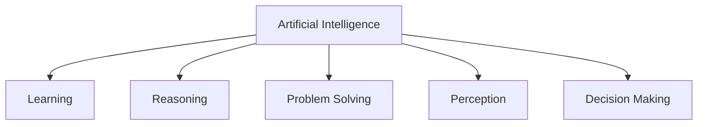
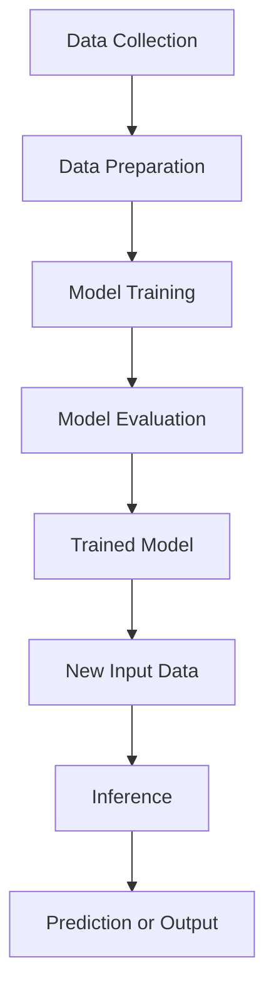
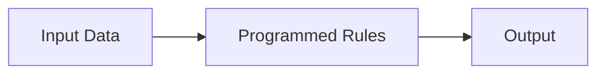
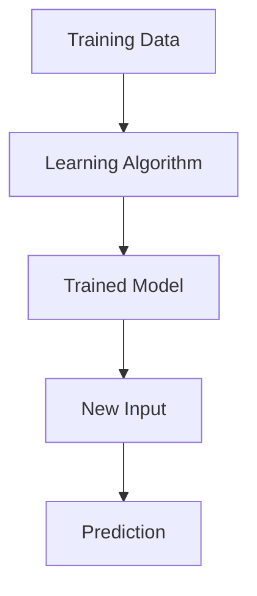
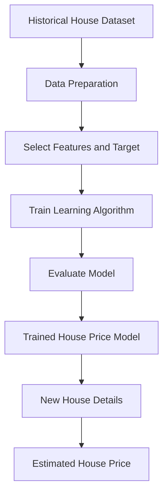
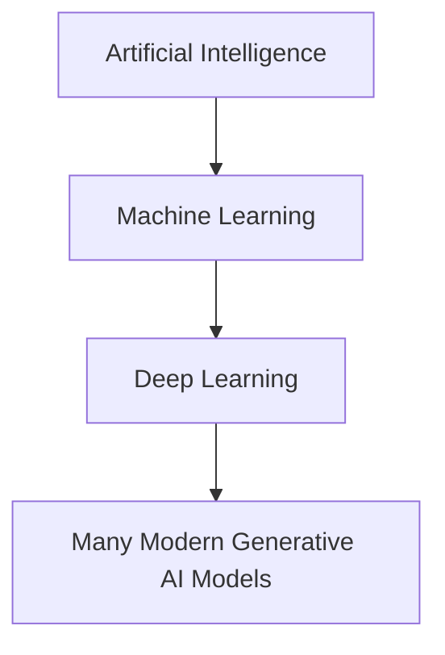

# 🎓 Class 01 – Introduction to Artificial Intelligence


## 📌 1. Learning Objectives

By the end of this class, learners will be able to:

- Define Artificial Intelligence and explain its purpose.
- Understand the major capabilities of AI.
- Describe a typical Machine Learning-based AI workflow.
- Differentiate traditional programming from Machine Learning.
- Understand fundamental AI and ML terminology.
- Identify real-world applications of AI.

---

## 🤖 2. Introduction to Artificial Intelligence

### Definition

Artificial Intelligence (AI) is a branch of Computer Science that focuses on developing computer systems capable of performing tasks that typically require human intelligence, such as learning, reasoning, problem-solving, perception, and decision-making.

### Key Characteristics

- Ability to process information.
- Learning patterns from data.
- Recognizing relationships.
- Interpreting different types of input.
- Supporting or automating decisions.
- Generating outputs based on rules or learned patterns.

### Examples

| Application | AI Capability |
|---|---|
| Face Unlock | Facial Recognition |
| Google Maps | Route Optimization |
| ChatGPT | Language Understanding and Generation |
| Gmail Spam Filter | Classification |
| Recommendation Systems | User Preference Prediction |
| Fraud Detection | Anomaly and Pattern Detection |

**Important:** AI systems do not necessarily possess human-like consciousness or understanding. Their capabilities depend on their architecture, algorithms, training data, and operating environment.

---

## 🧠 3. Major Capabilities of Artificial Intelligence

### 3.1 Learning

Learning is the ability of a system to identify patterns and relationships from data or experience.

**Example:** An email classification model learns to distinguish spam messages from legitimate emails using previously labeled examples.

### 3.2 Reasoning

Reasoning involves using available information, logical relationships, rules, or learned representations to derive conclusions.

**Example:** A medical decision-support system analyzes patient information to identify possible health conditions.

### 3.3 Problem-Solving

Problem-solving refers to finding suitable solutions to a defined problem by evaluating possible alternatives.

**Example:** A navigation system searches for an appropriate route between two locations.

### 3.4 Perception

Perception is the ability to interpret information from the environment, including images, videos, audio, and sensor data.

**Examples:**
- Image recognition.
- Object detection.
- Speech recognition.
- Facial recognition.

### 3.5 Decision-Making

Decision-making involves selecting an action or outcome based on available information, objectives, and constraints.

**Example:** A fraud detection system flags a transaction when its characteristics indicate suspicious activity.

### Capability Overview



---

## ⚙️ 4. How Does an AI System Work?

AI systems can use different approaches, including predefined rules, search techniques, Machine Learning, and Deep Learning.

A typical Machine Learning-based system follows this workflow:



### Explanation of the Workflow

| Stage | Description |
|---|---|
| Data Collection | Gathering relevant information from different sources. |
| Data Preparation | Cleaning, organizing, and transforming collected data. |
| Model Training | Applying a learning algorithm to identify patterns in training data. |
| Model Evaluation | Measuring model performance using suitable evaluation methods. |
| Inference | Applying the trained model to new input data. |
| Prediction | Producing an output based on the new input. |

**Note:** This is a common Machine Learning workflow, not a universal workflow for every AI system.

---

## 💻 5. Traditional Programming vs Machine Learning

### 5.1 Traditional Programming

Traditional programming is an approach in which developers explicitly define instructions and logical rules to solve a problem.

**Workflow:**



**Python Example:**

```python
temperature = 38

if temperature > 37:
    print("High temperature")
else:
    print("Normal temperature")
```

**Explanation:**

- `temperature = 38`: Assigns a numeric value to a variable.
- `if temperature > 37`: Checks whether the temperature exceeds 37.
- `print()`: Displays the corresponding result.

The output is:

```text
High temperature
```

### 5.2 Machine Learning

Machine Learning is an approach in which algorithms learn patterns and relationships from data to make predictions or decisions.

**Workflow:**



### Comparison

| Traditional Programming | Machine Learning |
|---|---|
| Explicit rules are written by developers. | Patterns are learned from data. |
| Input and rules produce output. | Training data and an algorithm produce a model. |
| Suitable for well-defined rule-based tasks. | Useful for complex data-driven prediction tasks. |
| Rule changes generally require code modifications. | Model updates may require retraining. |

**Important:** Machine Learning is a subset of Artificial Intelligence. Not every AI system uses Machine Learning.

---

## 📚 6. Fundamental AI and ML Terminology

### 6.1 Dataset

A dataset is an organized collection of related data used for analysis, processing, or model development.

### 6.2 Feature

A feature is an input variable used by a Machine Learning model to make predictions.

**House Price Prediction Examples:**
- Area.
- Number of bedrooms.
- Location score.

### 6.3 Label / Target

A label or target is the expected output that a supervised Machine Learning model is trained to predict.

**Example:** House price.

### 6.4 Algorithm

An algorithm is a defined procedure or sequence of steps used to solve a computational problem.

In Machine Learning, a learning algorithm uses data to identify patterns and construct a model.

### 6.5 Model

A model is the learned representation produced by a learning algorithm after being trained on data.

### 6.6 Training

Training is the process of applying a learning algorithm to training data so that it can identify patterns and relationships.

### 6.7 Inference

Inference is the process of applying a trained model to new input data to generate an output.

### 6.8 Prediction

A prediction is the output generated by a trained model for a given input.

### 6.9 Evaluation

Evaluation is the process of measuring model performance using appropriate metrics and evaluation data.

---

## 🏠 7. Real-World Example: House Price Prediction

Consider a system designed to estimate house prices using historical property information.

### Sample Dataset

| Area (sq. ft.) | Bedrooms | Location Score | Price |
|---:|---:|---:|---:|
| 1000 | 2 | 7 | 3000000 |
| 1500 | 3 | 8 | 4500000 |
| 2000 | 3 | 9 | 6500000 |
| 1200 | 2 | 6 | 3200000 |
| 1800 | 4 | 8 | 5800000 |

### Identify the Variables

- Features: Area, Bedrooms, Location Score.
- Target: Price.

### Workflow



This is an example of a supervised Machine Learning regression problem.

---

## 🌍 8. Real-World Applications of AI

| Domain | Applications |
|---|---|
| Healthcare | Medical image analysis, clinical decision support, disease risk prediction |
| Banking | Fraud detection, credit risk analysis, transaction monitoring |
| E-Commerce | Recommendation systems, product ranking, customer behavior analysis |
| Transportation | Traffic prediction, route optimization, driver assistance |
| Education | Personalized learning, automated feedback, AI tutoring |
| Manufacturing | Predictive maintenance, defect detection, quality inspection |
| Cybersecurity | Threat detection, anomaly detection, suspicious activity monitoring |

---

## 🔗 9. Relationship Between AI, ML, DL and Generative AI

### Artificial Intelligence (AI)

The broad field of developing systems that perform tasks associated with intelligence.

### Machine Learning (ML)

A subset of AI that enables systems to learn patterns from data.

### Deep Learning (DL)

A specialized area of Machine Learning based on neural networks with multiple layers.

### Generative AI

A field of AI focused on generating new content, including text, images, audio, video, and code.

### Simplified Relationship



**Conceptual clarification:** Generative AI is not strictly a nested layer within Deep Learning. It is a capability and application area that frequently uses Deep Learning architectures.

---

## 🎯 10. Interview Questions and Answers

### Q1. What is Artificial Intelligence?

Artificial Intelligence is a branch of Computer Science that focuses on developing systems capable of performing tasks that typically require human intelligence, including learning, reasoning, perception, problem-solving, and decision-making.

### Q2. What are the major capabilities of AI?

The major capabilities include learning, reasoning, problem-solving, perception, and decision-making.

### Q3. What is the difference between AI and Machine Learning?

Artificial Intelligence is the broader field of developing intelligent systems. Machine Learning is a subset of AI that enables systems to learn patterns from data and make predictions or decisions.

### Q4. Does every AI system use Machine Learning?

No. AI systems can also use predefined rules, search algorithms, logical reasoning, and expert-system techniques without learning from data.

### Q5. What is the difference between training and inference?

Training is the process of learning patterns from data. Inference is the process of using a trained model to generate outputs for new input data.

### Q6. What is the difference between a feature and a target?

A feature is an input variable used by a model. A target is the expected output that the model is trained to predict.

### Q7. What is a Machine Learning model?

A Machine Learning model is the learned representation produced by a learning algorithm after training on data.

### Q8. What is ANI?

Artificial Narrow Intelligence refers to AI systems designed to perform specific tasks or a limited range of tasks.

### Q9. Give examples of AI in everyday life.

Examples include face recognition, spam filtering, recommendation systems, navigation applications, voice assistants, and AI chatbots.

### Q10. Can AI make incorrect predictions?

Yes. AI systems can produce incorrect results because of insufficient or biased data, model limitations, unsuitable assumptions, and changing real-world conditions.

---

## 📝 11. Practical Exercise

### Problem Statement

You are developing a Machine Learning application that predicts house prices.

Identify the following:

1. What is the dataset?
2. Which columns should be used as features?
3. What is the target variable?
4. What is the purpose of model training?
5. What happens during inference?
6. How can the model's performance be evaluated?

### Expected Learning Outcome

Understand the structure of a basic supervised Machine Learning problem and identify its major components.

---

## 📖 12. Class Summary

In this class, we explored:

- Definition and purpose of Artificial Intelligence.
- Major capabilities of AI.
- A typical Machine Learning workflow.
- Traditional Programming vs Machine Learning.
- Fundamental AI and ML terminology.
- Real-world applications of AI.
- Relationship between AI, ML, DL, and Generative AI.

**Next Class:** Class 02 – History and Evolution of Artificial Intelligence.