# 🎓 AI Engineer Master Training – Class 02
# History and Evolution of Artificial Intelligence (AI)

**Level:** Beginner to Advanced  
**Module:** Artificial Intelligence  
**Class:** 02  
**Learning Goal:** Understand how Artificial Intelligence evolved from early computing ideas to modern Generative AI, Large Language Models, RAG, and AI Agents.

---

## 📚 1. Introduction to the History of Artificial Intelligence

### 🟢 Telugu Understanding

Artificial Intelligence ఒక్క రోజులో పుట్టిన technology కాదు. దశాబ్దాలుగా జరిగిన research, experiments, failures, improvements వల్ల AI ఈరోజు మనం చూస్తున్న స్థాయికి వచ్చింది.

మొదట్లో కంప్యూటర్లు మనం ఇచ్చిన instructions ప్రకారం మాత్రమే పనిచేసేవి. తరువాత researchers కంప్యూటర్లకు human intelligence లాంటి abilities ఇవ్వాలని ప్రయత్నించారు.

ఉదాహరణకు:

- మనిషిలా ఆలోచించడం.
- ప్రశ్నలకు సమాధానాలు ఇవ్వడం.
- Chess వంటి games ఆడడం.
- Data నుంచి patterns నేర్చుకోవడం.
- Images లో objects గుర్తించడం.
- Human language అర్థం చేసుకోవడం.
- కొత్త text, images, code generate చేయడం.

ఈ ప్రయత్నాలే Artificial Intelligence development కి పునాది అయ్యాయి.

### 🔵 English Definition

**The History of Artificial Intelligence** describes the development of computer systems designed to perform tasks that typically require human intelligence, including reasoning, learning, problem-solving, perception, and language understanding.

---

## 🏛️ 2. Early Foundations of AI

Modern AI officially emerged as a research field in 1956. However, its foundations were developed much earlier.

### 2.1 Charles Babbage (1791–1871)

🟢 **Telugu Understanding**

Charles Babbage ను "Father of the Computer" అని పిలుస్తారు.

ఆయన ఒక programmable mechanical computer design చేయాలని ప్రయత్నించారు. దాని పేరు **Analytical Engine**.

ఆ కాలంలో computers లేవు. అయినప్పటికీ, ఒక machine కి instructions ఇచ్చి calculations చేయించవచ్చనే ఆలోచనను ఆయన అభివృద్ధి చేశారు.

ఇది modern computing development కి ముఖ్యమైన పునాది.

🔵 **English Definition**

Charles Babbage was a mathematician and inventor who designed the Analytical Engine, an early concept of a general-purpose programmable mechanical computer.

### 2.2 Ada Lovelace (1815–1852)

🟢 **Telugu Understanding**

Ada Lovelace, Charles Babbage యొక్క Analytical Engine పై పనిచేశారు.

ఆమె ఒక machine కేవలం mathematical calculations మాత్రమే కాకుండా, సరైన instructions ఇస్తే ఇతర operations కూడా చేయగలదని గుర్తించారు.

ఆమె Analytical Engine కోసం ఒక algorithm రాశారు. అందుకే ఆమెను తరచుగా **the first computer programmer** అని పిలుస్తారు.

🔵 **English Definition**

Ada Lovelace is widely regarded as the first computer programmer because she developed an algorithm intended to be executed by Charles Babbage's Analytical Engine.

### 💡 Why are they important to AI?

Babbage programmable machines అనే ఆలోచనకు పునాది వేశారు. Ada Lovelace machines instructions ద్వారా వివిధ పనులు చేయగలవనే ఆలోచనను ముందుకు తీసుకెళ్లారు.

ఈ concepts తరువాత computer science మరియు AI development కి పునాదిగా నిలిచాయి.

---

## 🧠 3. Alan Turing – The Foundation of Modern AI

<ins>Year: 1950</ins>

🟢 **Telugu Understanding**

Alan Turing ఒక British mathematician మరియు computer scientist.

ఆయన ఒక ముఖ్యమైన ప్రశ్న అడిగారు:

**"Can machines think?"**

అంటే, మనుషుల్లాగా కంప్యూటర్లు కూడా ఆలోచించగలవా?

1950లో ఆయన **Computing Machinery and Intelligence** అనే research paper ప్రచురించారు.

ఈ paper లో ఒక ముఖ్యమైన idea ని పరిచయం చేశారు. అదే **Turing Test**.

### 3.1 What is the Turing Test?

ఒక human evaluator, ఒక machine మరియు ఒక human తో text ద్వారా conversation చేస్తాడు.

ఆ evaluator ఎవరు machine, ఎవరు human అని సరిగ్గా గుర్తించలేకపోతే, ఆ machine human-like conversational behaviour చూపించిందని భావిస్తారు.

### 📊 Turing Test – Flowchart

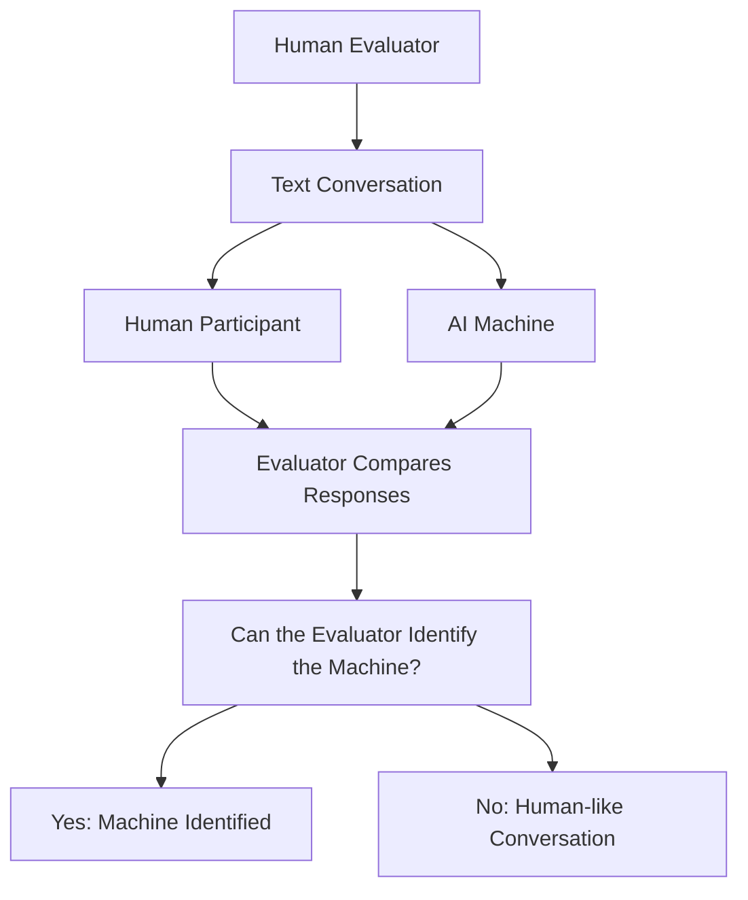

🔵 **English Definition**

The Turing Test, proposed by Alan Turing in 1950, evaluates whether a machine can exhibit conversational behaviour that is indistinguishable from that of a human.

**Important:** Passing a Turing Test does not prove that a machine possesses consciousness or human-like understanding.

### 💡 Example

ఒక chatbot తో మాట్లాడుతున్నప్పుడు అది human లాగా responses ఇస్తే, మనం అది human లేదా machine అని గుర్తించలేకపోవచ్చు.

ఇది Turing Test concept కి ఒక simple example.

---

## 🎯 4. Birth of Artificial Intelligence – Dartmouth Conference

<ins>Year: 1956</ins>

🟢 **Telugu Understanding**

1956లో USA లోని Dartmouth College లో ఒక important research workshop జరిగింది.

దాని పేరు **Dartmouth Summer Research Project on Artificial Intelligence**.

ఈ workshop లో John McCarthy, Marvin Minsky, Claude Shannon, Nathaniel Rochester వంటి researchers పాల్గొన్నారు.

**John McCarthy** అనే researcher "Artificial Intelligence" అనే పదాన్ని పరిచయం చేశారు.

ఈ conference ని AI ఒక formal research field గా ప్రారంభమైన ముఖ్యమైన milestone గా గుర్తిస్తారు.

🔵 **English Definition**

The Dartmouth Conference of 1956 is widely considered the founding event of Artificial Intelligence as a formal research field. The term "Artificial Intelligence" was introduced by John McCarthy.

### 📌 Important Facts

| Detail | Information |
|---|---|
| Year | 1956 |
| Location | Dartmouth College, USA |
| Important researcher | John McCarthy |
| Major contribution | Introduction of the term Artificial Intelligence |
| Significance | AI emerged as a formal research field |

---

## ⚙️ 5. Rule-Based AI / Symbolic AI

<ins>Early AI Approach: 1950s–1980s</ins>

🟢 **Telugu Understanding**

ప్రారంభంలో AI systems కి మనుషుల్లాగా data నుంచి నేర్చుకునే సామర్థ్యం ఎక్కువగా ఉండేది కాదు.

Researchers ముందుగానే rules రాసి కంప్యూటర్లకు ఇచ్చేవారు.

ఆ rules ఆధారంగా computer decisions తీసుకునేది.

దీనినే **Rule-Based AI** లేదా **Symbolic AI** అంటారు.

### 💡 Example

ఒక simple rule-based system లో:

```python
temperature = 38

if temperature > 37:
    print("High temperature detected")
else:
    print("Normal temperature")
```

ఇక్కడ computer కి మనం ముందుగానే ఒక rule ఇచ్చాము.

- Temperature 37 కంటే ఎక్కువైతే → High temperature.
- లేకపోతే → Normal temperature.

Computer తనంతట తాను కొత్తగా నేర్చుకోవడం లేదు. ఇచ్చిన rule ప్రకారమే result ఇస్తోంది.

### 📊 Rule-Based AI Flowchart

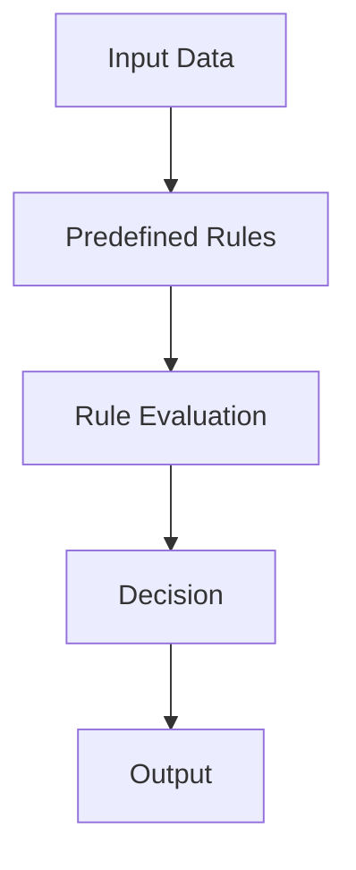

🔵 **English Definition**

Rule-Based AI is an approach in which a system makes decisions using predefined rules, logical conditions, and human-programmed knowledge rather than learning patterns directly from data.

### ⚖️ Advantages and Limitations

| Advantages | Limitations |
|---|---|
| Easy to understand | Difficult to manage many rules |
| Predictable outputs | Cannot automatically learn new patterns |
| Useful for fixed conditions | Struggles with complex, changing situations |

---

## 🎮 6. Arthur Samuel and Machine Learning Foundations

<ins>Year: 1959</ins>

🟢 **Telugu Understanding**

Arthur Samuel అనే computer scientist, computer కి ప్రతి move ని manually program చేయకుండా, experience ద్వారా improve అయ్యే విధంగా checkers game program పై పనిచేశారు.

ఒక computer game ఆడుతూ తన previous experience నుంచి improve అవ్వగలదనే idea ని ఆయన చూపించారు.

ఇది Machine Learning development లో ముఖ్యమైన milestone.

Arthur Samuel 1959లో Machine Learning అనే పదాన్ని ఉపయోగించిన pioneers లో ఒకరు.

🔵 **English Definition**

Arthur Samuel was a pioneer of Machine Learning who developed a checkers-playing program that improved its performance through experience.

### 💡 Example

ఒక computer మొదట్లో Checkers game సరిగ్గా ఆడలేకపోవచ్చు.

కానీ games ఆడుతూ previous results నుంచి patterns నేర్చుకొని తన performance ని improve చేసుకోవచ్చు.

ఇది machine learning యొక్క basic idea.

---

## ❄️ 7. AI Winters

<ins>Major Periods: 1970s and Late 1980s–1990s</ins>

🟢 **Telugu Understanding**

AI ప్రారంభమైనప్పుడు researchers చాలా పెద్ద expectations పెట్టుకున్నారు.

కొన్ని సంవత్సరాల్లోనే computers మనుషుల్లాగా అన్ని పనులు చేస్తాయని అనుకున్నారు.

కానీ ఆ కాలంలో:

- Computers కి processing power తక్కువగా ఉండేది.
- Data availability పరిమితంగా ఉండేది.
- AI algorithms కి technical limitations ఉండేవి.
- Research costs ఎక్కువగా ఉండేవి.
- Expected results సాధించడం కష్టంగా ఉండేది.

దీంతో AI పై పెట్టుబడులు, funding మరియు research interest తగ్గాయి.

AI research మరియు funding తగ్గిపోయిన ఈ periods ని **AI Winters** అంటారు.

### 🔵 English Definition

An AI Winter is a period of reduced funding, research activity, and public interest in Artificial Intelligence due to unmet expectations and technological limitations.

### 📊 AI Winter Timeline

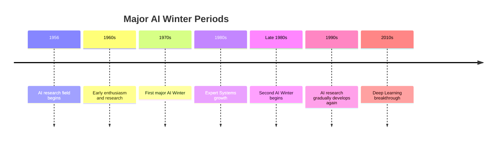

**Important:** AI Winters did not mean that all AI research stopped. Research continued, but funding and enthusiasm decreased significantly.

---

## 🧑‍⚕️ 8. Expert Systems

<ins>Major Growth: 1970s–1980s</ins>

🟢 **Telugu Understanding**

AI Winter సమయంలో కూడా AI research పూర్తిగా ఆగిపోలేదు.

ఆ సమయంలో **Expert Systems** అనే AI approach అభివృద్ధి చెందింది.

Expert System అంటే ఒక particular domain లో human expert లాగా decisions ఇవ్వడానికి ప్రయత్నించే computer system.

ఉదాహరణకు:

ఒక medical expert కి కొన్ని symptoms ఆధారంగా possible disease గురించి knowledge ఉంటుంది.

ఆ knowledge ని rules రూపంలో computer లో store చేస్తే, system ఆ rules ఆధారంగా possible suggestions ఇవ్వగలదు.

### 8.1 Main Components of an Expert System

**1. Knowledge Base**

Domain కి సంబంధించిన facts మరియు rules ఇందులో store అవుతాయి.

**2. Inference Engine**

Knowledge Base లోని rules ని ఉపయోగించి conclusions తీసుకుంటుంది.

### 📊 Expert System Architecture

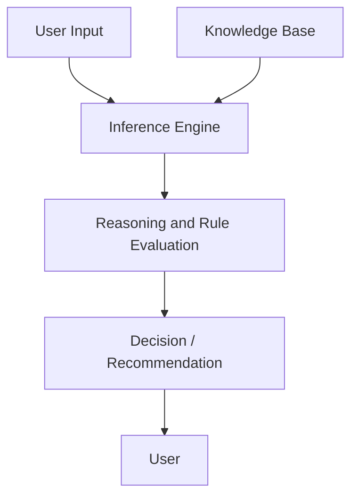

🔵 **English Definition**

An Expert System is an AI program that uses a knowledge base and an inference engine to solve problems or make decisions within a specific domain.

### 💡 Example

```text
IF fever = YES
AND cough = YES
THEN suggest medical evaluation
```

ఇది ఒక simplified example మాత్రమే. Real medical diagnosis కోసం professional medical evaluation అవసరం.

---

## 🤖 9. Machine Learning (ML)

<ins>Major Development: 1980s–2000s</ins>

🟢 **Telugu Understanding**

Traditional programming లో మనం computer కి rules రాస్తాము.

కానీ Machine Learning లో computer కి data ఇస్తాము. ఆ data లో ఉన్న patterns ని algorithm నేర్చుకుంటుంది.

ఉదాహరణకు, మన దగ్గర house prices dataset ఉందనుకుందాం.

దాంట్లో:

- House area
- Number of bedrooms
- Location
- House price

వంటి details ఉంటాయి.

ఈ data ఉపయోగించి Machine Learning model కొత్త house price ని predict చేయడం నేర్చుకోగలదు.

### 9.1 Traditional Programming vs Machine Learning

| Traditional Programming | Machine Learning |
|---|---|
| Human writes rules | Algorithm learns patterns from data |
| Input + Rules → Output | Input Data + Expected Outputs → Trained Model |
| Rules are explicitly programmed | Model parameters are learned during training |

### 📊 Machine Learning Process

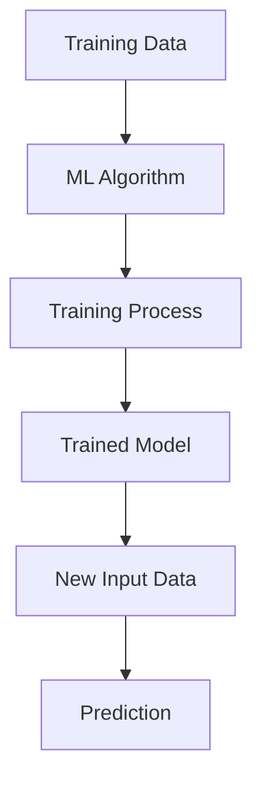

🔵 **English Definition**

Machine Learning is a branch of Artificial Intelligence that enables computer systems to learn patterns from data and improve their performance on tasks without being explicitly programmed for every individual case.

### 💡 Real-World Applications

- Email spam detection.
- House price prediction.
- Fraud detection.
- Product recommendations.
- Customer churn prediction.

---

## ♟️ 10. IBM Deep Blue vs Garry Kasparov

<ins>Year: 1997</ins>

🟢 **Telugu Understanding**

1997లో IBM సంస్థ అభివృద్ధి చేసిన **Deep Blue** అనే chess computer system, World Chess Champion Garry Kasparov ని six-game match లో ఓడించింది.

ఇది AI history లో చాలా important milestone.

Deep Blue చాలా chess positions ని search చేసి, వాటిని evaluate చేసి మంచి moves ఎంచుకునేది.

ఇది ChatGPT లాంటి Generative AI కాదు. Chess కోసం ప్రత్యేకంగా రూపొందించిన system.

🔵 **English Definition**

IBM Deep Blue was a specialized chess-playing computer that defeated world chess champion Garry Kasparov in a six-game match in 1997.

### 💡 Why is it important?

ఇది computers complex strategic games లో human champions ని కూడా ఓడించగలవని ప్రపంచానికి చూపించింది.

---

## 🧠 11. Deep Learning

<ins>Major Breakthrough: 2012</ins>

🟢 **Telugu Understanding**

Deep Learning అనేది Machine Learning లో ఒక subfield.

ఇది human brain లోని neurons పని చేసే విధానం నుంచి inspiration తీసుకున్న **Artificial Neural Networks** ఉపయోగిస్తుంది.

ఒక neural network లో multiple layers ఉంటాయి.

ప్రతి layer input లోని different patterns ని గుర్తించడానికి సహాయపడుతుంది.

ఉదాహరణకు, ఒక image లో dog ఉందా లేదా అని గుర్తించాలంటే:

- మొదటి layers edges మరియు lines గుర్తించవచ్చు.
- మధ్య layers shapes మరియు patterns గుర్తించవచ్చు.
- చివరి layers dog వంటి object ని classify చేయవచ్చు.

ఇది ఒక simplified explanation.

### 11.1 Neural Network Structure

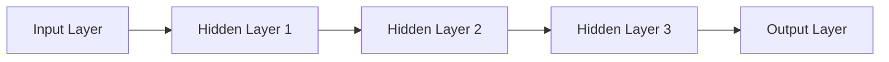

🔵 **English Definition**

Deep Learning is a subfield of Machine Learning that uses neural networks with multiple layers to automatically learn complex patterns and representations from data.

### 11.2 AlexNet – 2012

🟢 **Telugu Understanding**

2012లో **AlexNet** అనే deep neural network, ImageNet Large Scale Visual Recognition Challenge లో image classification performance లో ఒక major breakthrough సాధించింది.

దీంతో Deep Learning పై research interest చాలా పెరిగింది.

GPUs, large datasets మరియు improved algorithms కూడా Deep Learning growth కి సహాయపడ్డాయి.

🔵 **English Definition**

AlexNet is a deep convolutional neural network that achieved a major breakthrough in the 2012 ImageNet Large Scale Visual Recognition Challenge, helping accelerate the adoption of Deep Learning.

### 💡 Deep Learning Applications

- Face recognition.
- Object detection.
- Speech recognition.
- Medical image analysis.
- Self-driving vehicle perception.

---

## 🔤 12. Natural Language Processing (NLP)

🟢 **Telugu Understanding**

మనుషులు మాట్లాడే భాషను computers process చేయడం, analyze చేయడం మరియు అర్థం చేసుకోవడానికి ఉపయోగించే AI domain ని Natural Language Processing అంటారు.

మనిషి Telugu, English, Hindi వంటి languages లో communicate చేస్తాడు.

Computer కి language ని process చేయడానికి special techniques మరియు models అవసరం.

### 💡 Examples

- Google Translate.
- Voice assistants.
- Sentiment analysis.
- Chatbots.
- Text summarization.

🔵 **English Definition**

Natural Language Processing (NLP) is a field of Artificial Intelligence that enables computers to process, analyze, interpret, and generate human language.

---

## 🔄 13. Transformer Architecture

<ins>Year: 2017</ins>

🟢 **Telugu Understanding**

2017లో Google researchers **Attention Is All You Need** అనే research paper ని ప్రచురించారు.

ఈ paper లో Transformer architecture ని పరిచయం చేశారు.

Transformer architecture లో ముఖ్యమైన concept **Attention Mechanism**.

Attention అంటే ఒక sentence లో ఏ words కి ఎక్కువ importance ఇవ్వాలో model నేర్చుకోవడానికి సహాయపడే mechanism.

### 💡 Example

Sentence:

```text
The animal didn't cross the road because it was tired.
```

ఇక్కడ "it" అనే word ఏ entity ని refer చేస్తుందో అర్థం చేసుకోవడానికి sentence లోని ఇతర words తో సంబంధాన్ని పరిశీలించాలి.

Attention mechanism ఇలాంటి relationships ని capture చేయడంలో సహాయపడుతుంది.

### 📊 Simplified Transformer Flow

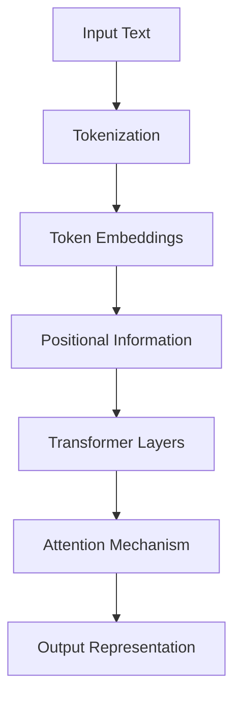

🔵 **English Definition**

The Transformer is a neural network architecture introduced in the 2017 research paper "Attention Is All You Need." It uses attention mechanisms to model relationships between tokens and has become the foundation of many modern language models.

### 💡 Why is Transformer important?

Transformer architecture ఆధారంగా తరువాత అనేక powerful language models అభివృద్ధి అయ్యాయి.

Examples:

- BERT.
- GPT family.
- T5.
- Modern Large Language Models.

---

## ✨ 14. Generative AI

<ins>Major Public Breakthrough: 2020s</ins>

🟢 **Telugu Understanding**

Traditional AI systems ఎక్కువగా prediction, classification, detection వంటి tasks చేస్తాయి.

Generative AI మాత్రం existing patterns నేర్చుకొని కొత్త content create చేయగలదు.

ఇది generate చేయగల content:

- Text.
- Images.
- Audio.
- Video.
- Computer code.

### 💡 Example

మీరు AI కి:

```text
Write a Python program to check whether a number is prime.
```

అని prompt ఇస్తే, AI కొత్త Python code generate చేయగలదు.

అలాగే ఒక image generate చేయమంటే image create చేయగలదు.

🔵 **English Definition**

Generative AI is a category of Artificial Intelligence that creates new content, such as text, images, audio, video, and code, based on patterns learned from training data.

### 📊 Traditional AI vs Generative AI

| Traditional AI | Generative AI |
|---|---|
| Often predicts or classifies | Generates new content |
| Detects spam emails | Generates an email draft |
| Classifies an image | Generates a new image |
| Predicts house prices | Generates a property description |

---

## 📚 15. Large Language Models (LLMs)

🟢 **Telugu Understanding**

Large Language Model అంటే చాలా పెద్ద text datasets పై train చేసిన language model.

ఇవి language లోని patterns, grammar, context మరియు relationships నేర్చుకుంటాయి.

ఒక LLM కి prompt ఇస్తే, అది తరువాత వచ్చే tokens ని predict చేస్తూ response generate చేస్తుంది.

### 💡 Example

Prompt:

```text
Artificial Intelligence is
```

ఒక language model తరువాత వచ్చే suitable words ని predict చేస్తూ sentence ని complete చేయగలదు.

Modern LLMs question answering, summarization, coding, translation వంటి పనులు చేయగలవు.

🔵 **English Definition**

A Large Language Model (LLM) is a language model trained on large amounts of text data to understand and generate human-like text by predicting sequences of tokens.

### 📌 Examples of LLMs

- GPT models.
- Google Gemini models.
- Anthropic Claude models.
- Meta Llama models.

---

## 💬 16. ChatGPT – Public Release

<ins>Date: November 30, 2022</ins>

🟢 **Telugu Understanding**

OpenAI, November 30, 2022న ChatGPT ని public research preview గా విడుదల చేసింది.

దీంతో సాధారణ users కూడా conversational AI ని చాలా సులభంగా ఉపయోగించడం ప్రారంభించారు.

Users questions అడగడం, explanations తీసుకోవడం, code రాయించుకోవడం, summaries తయారు చేయించుకోవడం వంటి పనులు చేయగలిగారు.

ఇది Generative AI adoption వేగంగా పెరగడానికి ఒక ముఖ్యమైన milestone.

🔵 **English Definition**

ChatGPT is a conversational AI system developed by OpenAI and publicly released as a research preview on November 30, 2022.

### 💡 Applications

- Learning and education.
- Programming assistance.
- Content generation.
- Research support.
- Data analysis.
- Productivity automation.

---

## 🔎 17. Retrieval-Augmented Generation (RAG)

🟢 **Telugu Understanding**

ఒక LLM కి training సమయంలో నేర్చుకున్న knowledge ఉంటుంది. కానీ కొన్ని సందర్భాల్లో మనకు specific documents, company data లేదా latest information ఆధారంగా answers కావాలి.

అప్పుడు RAG ఉపయోగపడుతుంది.

RAG లో model response generate చేసే ముందు external knowledge source నుంచి relevant information retrieve చేస్తుంది.

ఉదాహరణకు:

ఒక company దగ్గర 1000 PDF documents ఉన్నాయని అనుకుందాం.

ఒక employee:

```text
What is our company's leave policy?
```

అని అడిగితే, RAG system company documents లో relevant information search చేసి, ఆ information ఆధారంగా LLM answer generate చేయడానికి సహాయపడుతుంది.

### 📊 RAG Architecture

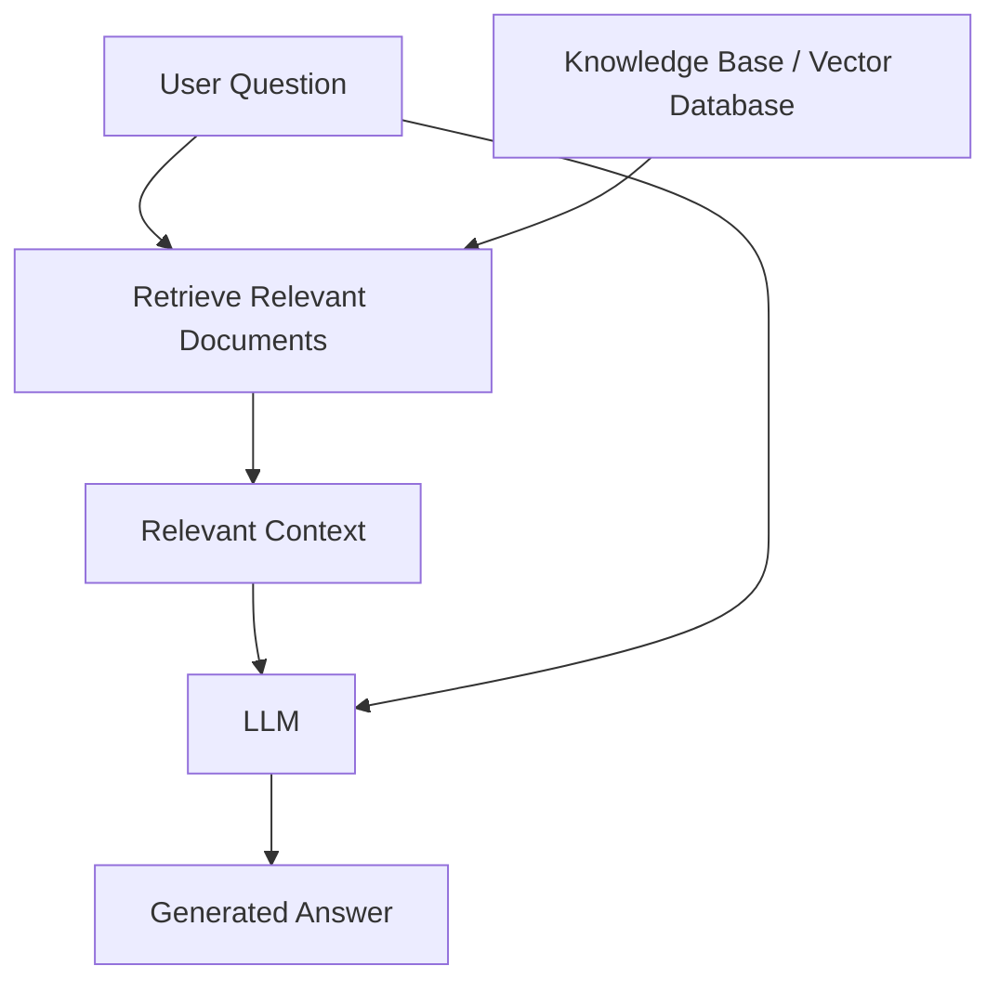

🔵 **English Definition**

Retrieval-Augmented Generation (RAG) is an approach that improves language model responses by retrieving relevant information from external knowledge sources and providing it as context during generation.

### 💡 Real-World Applications

- Chat with PDF.
- Company knowledge assistants.
- Customer support bots.
- Document question-answering systems.
- Internal enterprise search.

---

## 🤖 18. AI Agents and Agentic AI

🟢 **Telugu Understanding**

సాధారణ chatbot మనం అడిగిన ప్రశ్నకు answer ఇస్తుంది.

కానీ AI Agent ఒక goal ని complete చేయడానికి multiple steps plan చేసి, tools ఉపయోగించి actions తీసుకోగలదు.

ఉదాహరణకు:

మీరు ఒక AI Agent కి:

```text
Analyze this CSV file and create a report.
```

అని చెబితే, ఒక agent system:

1. CSV file ని read చేయవచ్చు.
2. Data ని analyze చేయవచ్చు.
3. Important patterns గుర్తించవచ్చు.
4. Report generate చేయవచ్చు.

ఇది agent architecture మరియు దానికి ఇచ్చిన permissions మీద ఆధారపడి ఉంటుంది.

### 📊 Simplified AI Agent Workflow

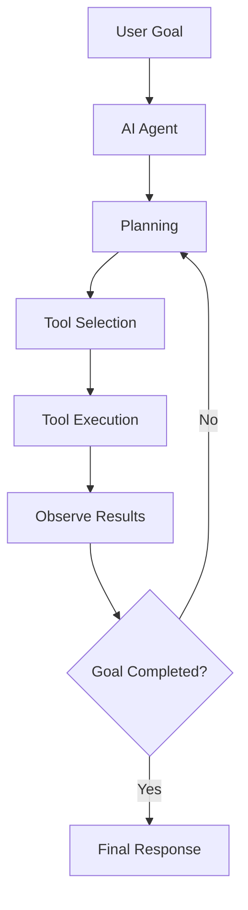

🔵 **English Definition**

An AI Agent is a system that uses an AI model to pursue a goal by reasoning, planning, interacting with tools, observing results, and performing actions within its available permissions.

### 💡 Applications

- Automated research assistants.
- Coding agents.
- Data analysis agents.
- Customer support automation.
- Workflow automation.

---

## 🔌 19. Model Context Protocol (MCP)

🟢 **Telugu Understanding**

AI models మరియు external tools లేదా data sources మధ్య communication చేయడానికి ఒక standard way అవసరం.

అందుకోసం Anthropic 2024లో **Model Context Protocol (MCP)** ని introduce చేసింది.

MCP ద్వారా compatible AI applications, MCP servers అందించే tools మరియు resources తో communicate చేయగలవు.

ఉదాహరణకు ఒక AI application కి:

- Files access.
- Database interaction.
- External tools.
- Other supported services.

వంటి capabilities అందించవచ్చు.

ఇవి MCP server అందించే capabilities మరియు permissions మీద ఆధారపడి ఉంటాయి.

### 📊 Simplified MCP Architecture

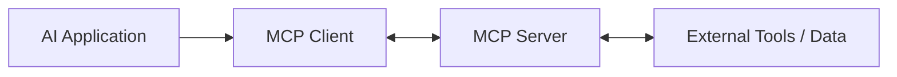

🔵 **English Definition**

Model Context Protocol (MCP) is an open protocol introduced by Anthropic in 2024 that standardizes how AI applications connect to external tools and data sources through MCP servers.

### 💡 Example

ఒక AI application MCP server ద్వారా compatible file-system tool ని access చేసి, permitted files గురించి information పొందవచ్చు.

---

## 🌐 20. Multimodal AI

🟢 **Telugu Understanding**

ఒక AI model కేవలం text మాత్రమే కాకుండా multiple types of data తో పని చేయగలిగితే దానిని Multimodal AI అంటారు.

ఉదాహరణకు:

మీరు ఒక image upload చేసి:

```text
What objects are present in this image?
```

అని అడిగితే, image ని analyze చేసి answer ఇవ్వగల AI system multimodal capability కలిగి ఉంటుంది.

### 📊 Multimodal AI

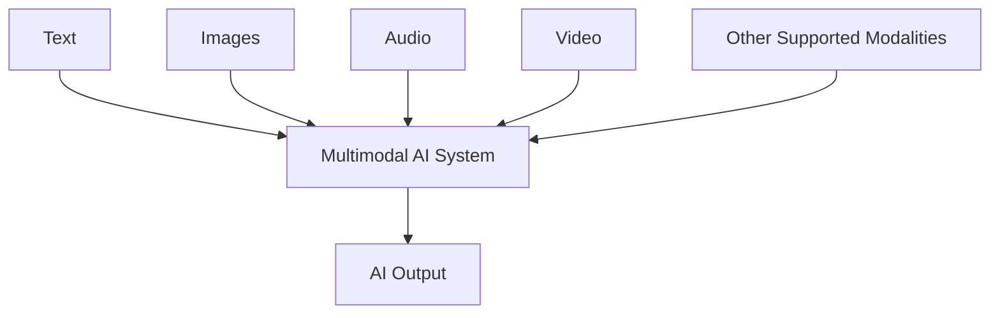

🔵 **English Definition**

Multimodal AI refers to Artificial Intelligence systems that can process, understand, or generate information across multiple data modalities, such as text, images, audio, and video.

### 💡 Applications

- Image question answering.
- Voice assistants.
- Video understanding.
- Text-to-image generation.
- Speech-to-text systems.

---

## ⚡ 21. Why Did AI Grow So Fast?

🟢 **Telugu Understanding**

AI development చాలా సంవత్సరాలుగా జరుగుతున్నప్పటికీ, recent years లో చాలా వేగంగా అభివృద్ధి చెందింది.

దానికి మూడు ముఖ్యమైన reasons ఉన్నాయి.

### 21.1 Availability of Large Amounts of Data

Internet, websites, sensors, mobile applications, digital platforms వల్ల చాలా పెద్ద మొత్తంలో data అందుబాటులోకి వచ్చింది.

ఈ data Machine Learning మరియు Deep Learning models train చేయడానికి సహాయపడింది.

### 21.2 Increased Computing Power

GPUs మరియు modern computing hardware వల్ల large-scale calculations వేగంగా చేయడం సాధ్యమైంది.

Deep Learning models train చేయడానికి ఇది చాలా ముఖ్యమైనది.

### 21.3 Improved Algorithms

Researchers కొత్త algorithms మరియు architectures అభివృద్ధి చేశారు.

ఉదాహరణలు:

- Neural Networks.
- CNNs.
- RNNs.
- Transformers.
- Attention Mechanisms.

### 📊 AI Growth – Three Major Factors

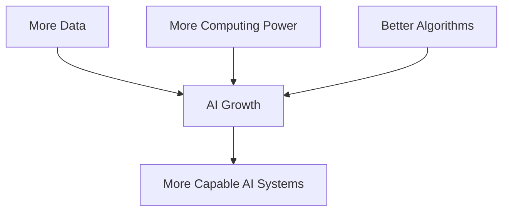

🔵 **English Definition**

The rapid growth of Artificial Intelligence has been driven by increased data availability, advances in computing hardware, and improvements in algorithms and model architectures.

---

# 🕰️ 22. Complete Timeline of Artificial Intelligence

ఈ timeline ద్వారా AI ఎలా evolve అయిందో ఒకే చోట చూడవచ్చు.

| Year / Period | Milestone | Contribution |
|---|---|---|
| 1830s | Charles Babbage | Analytical Engine design |
| 1840s | Ada Lovelace | Early computer algorithm |
| 1950 | Alan Turing | Computing Machinery and Intelligence |
| 1950 | Turing Test concept | Machine intelligence evaluation |
| 1956 | Dartmouth Conference | AI established as a formal research field |
| 1959 | Arthur Samuel | Machine Learning terminology and checkers program |
| 1970s | First AI Winter | Reduced funding and interest |
| 1970s–1980s | Expert Systems | Rule-based expert decision support |
| Late 1980s–1990s | Second AI Winter | Reduced AI investment |
| 1997 | IBM Deep Blue | Defeated Garry Kasparov |
| 2012 | AlexNet | Deep Learning breakthrough in ImageNet |
| 2017 | Transformer | Attention Is All You Need |
| 2022 | ChatGPT | Public research preview released |
| 2020s | Generative AI growth | Text, image, audio and code generation |
| 2024 | MCP | Standardized AI application connections to tools and data |

### 📊 AI Evolution – Complete Flowchart

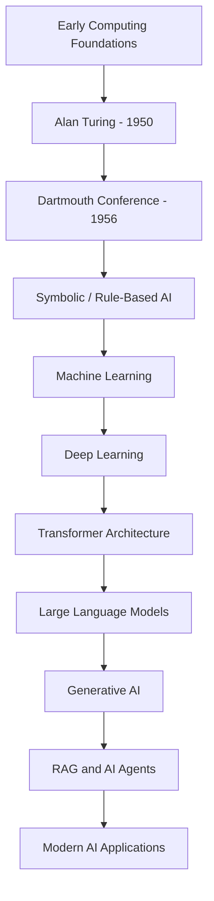

**Remember:** AI evolution is not a simple replacement of one technology by another. Older approaches such as rule-based systems and traditional Machine Learning are still useful today.

---

# 🔍 23. Important Differences – Quick Comparison

| Technology | Main Idea | Example |
|---|---|---|
| Rule-Based AI | Uses predefined rules | IF-THEN decision system |
| Machine Learning | Learns patterns from data | Spam detection |
| Deep Learning | Uses multilayer neural networks | Image recognition |
| NLP | Processes human language | Sentiment analysis |
| Generative AI | Creates new content | Text and image generation |
| LLM | Learns language patterns from large datasets | GPT, Gemini, Claude |
| RAG | Retrieves external information for generation | Chat with PDF |
| AI Agent | Plans and performs tasks using tools | Research assistant |
| Multimodal AI | Works with multiple data types | Image and text understanding |
| MCP | Connects AI applications with tools and data | AI application accessing an MCP server |

---

# 🎤 24. Interview Questions and Answers

### Q1. Who is known as the father of Artificial Intelligence?

**Answer:** John McCarthy is widely known as the Father of Artificial Intelligence because he introduced the term "Artificial Intelligence" in connection with the 1956 Dartmouth Conference.

### Q2. What is the Dartmouth Conference?

**Answer:** The Dartmouth Conference was a research workshop held in 1956 at Dartmouth College, USA. It is considered the founding event of AI as a formal research field.

### Q3. Who proposed the Turing Test?

**Answer:** Alan Turing proposed the Turing Test in his 1950 paper "Computing Machinery and Intelligence."

### Q4. What is an AI Winter?

**Answer:** An AI Winter is a period when funding, research activity, and public interest in AI decrease because of unmet expectations and technical limitations.

### Q5. What is the difference between Rule-Based AI and Machine Learning?

**Answer:** Rule-Based AI follows predefined human-written rules, whereas Machine Learning learns patterns from data to make predictions or decisions.

### Q6. What is an Expert System?

**Answer:** An Expert System is an AI program that uses a knowledge base and inference engine to solve problems in a specific domain.

### Q7. What is Deep Learning?

**Answer:** Deep Learning is a subset of Machine Learning that uses neural networks with multiple layers to learn complex patterns from data.

### Q8. Why is AlexNet important?

**Answer:** AlexNet achieved a major breakthrough in the 2012 ImageNet image classification challenge and helped accelerate the adoption of Deep Learning.

### Q9. What is the Transformer architecture?

**Answer:** The Transformer is a neural network architecture introduced in 2017 that uses attention mechanisms to model relationships between tokens.

### Q10. What is Generative AI?

**Answer:** Generative AI creates new content such as text, images, audio, video, and code based on patterns learned from training data.

### Q11. What is RAG?

**Answer:** Retrieval-Augmented Generation combines information retrieval with language generation by providing relevant external information as context to an LLM.

### Q12. What is an AI Agent?

**Answer:** An AI Agent is a system that uses an AI model to pursue goals through reasoning, planning, tool interaction, and action execution.

### Q13. What is MCP?

**Answer:** Model Context Protocol is an open protocol that standardizes how AI applications connect to external tools and data sources.

### Q14. What are the three major factors behind AI growth?

**Answer:** Increased data availability, improved computing power, and better algorithms are three major factors behind the rapid growth of AI.

---

# 📝 25. Class 02 – Knowledge Check

Try answering these questions without looking at the notes.

1. Who introduced the term Artificial Intelligence?
2. In which year was the Dartmouth Conference held?
3. What was the main idea behind the Turing Test?
4. What is the difference between Rule-Based AI and Machine Learning?
5. What does an Expert System contain?
6. What is an AI Winter?
7. Which computer defeated Garry Kasparov in 1997?
8. Why was AlexNet important in 2012?
9. Which research paper introduced the Transformer architecture?
10. What is the main purpose of Attention Mechanism?
11. When was ChatGPT released as a public research preview?
12. What problem does RAG help solve?
13. What makes an AI Agent different from a simple chatbot?
14. What is the purpose of MCP?
15. What are the three major factors behind AI growth?

---

# 🎯 26. Class 02 – Final Understanding

Artificial Intelligence has evolved through several stages:

- Early computing ideas established the foundation.
- Alan Turing introduced important questions about machine intelligence.
- The Dartmouth Conference established AI as a formal research field.
- Rule-Based AI used predefined logical rules.
- Machine Learning enabled systems to learn patterns from data.
- Deep Learning improved the ability to learn complex representations.
- Transformers helped build powerful modern language models.
- Generative AI enabled machines to create new content.
- RAG, AI Agents, MCP, and Multimodal AI are important parts of modern AI development.

**The most important lesson:** Modern AI is the result of decades of research, experimentation, failures, and technological improvements.

---

## 📚 Class 02 Completed

**Next Class:** Class 03 – Types of Artificial Intelligence

We will study two different ways to classify AI:

1. **Based on Capabilities:** Narrow AI, General AI (AGI), and Super AI (ASI).
2. **Based on Functionality:** Reactive Machines, Limited Memory, Theory of Mind, and Self-Aware AI.

We will also understand which types exist today and which remain theoretical.

---

**End of Class 02 – History and Evolution of Artificial Intelligence**