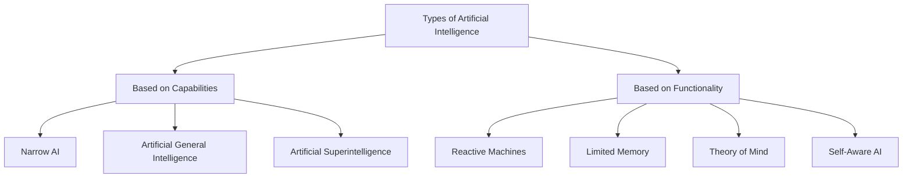
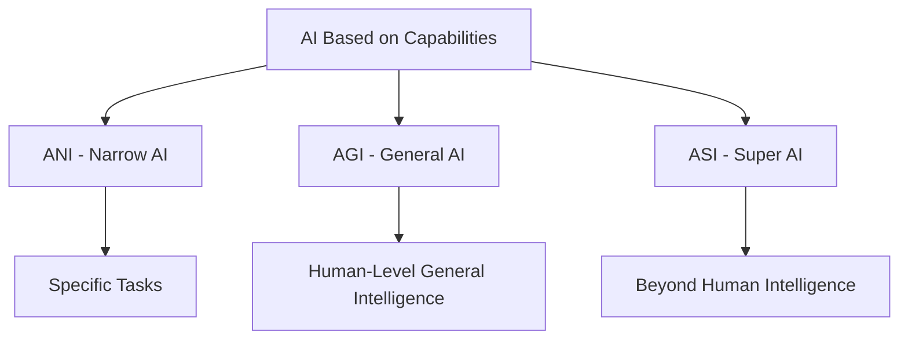
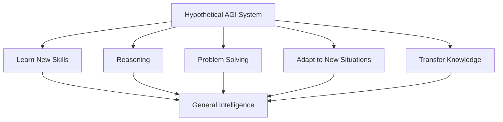
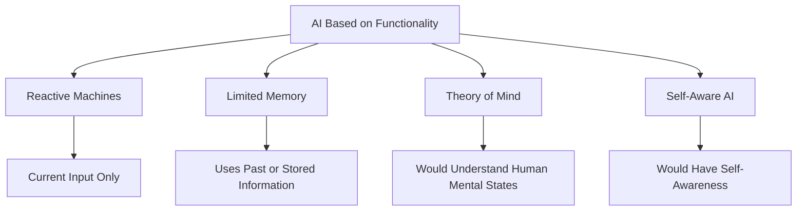
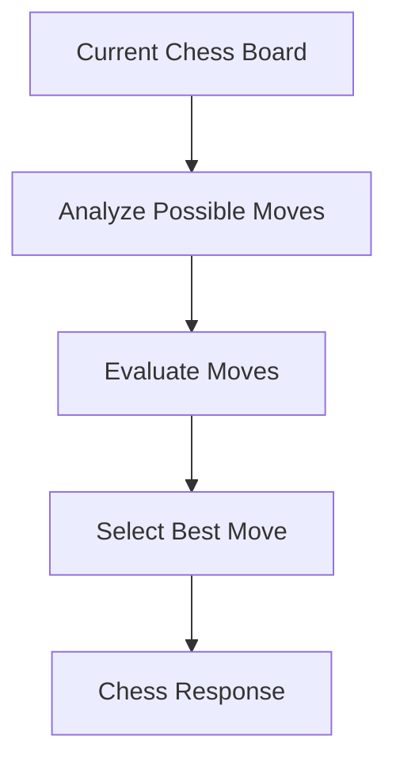
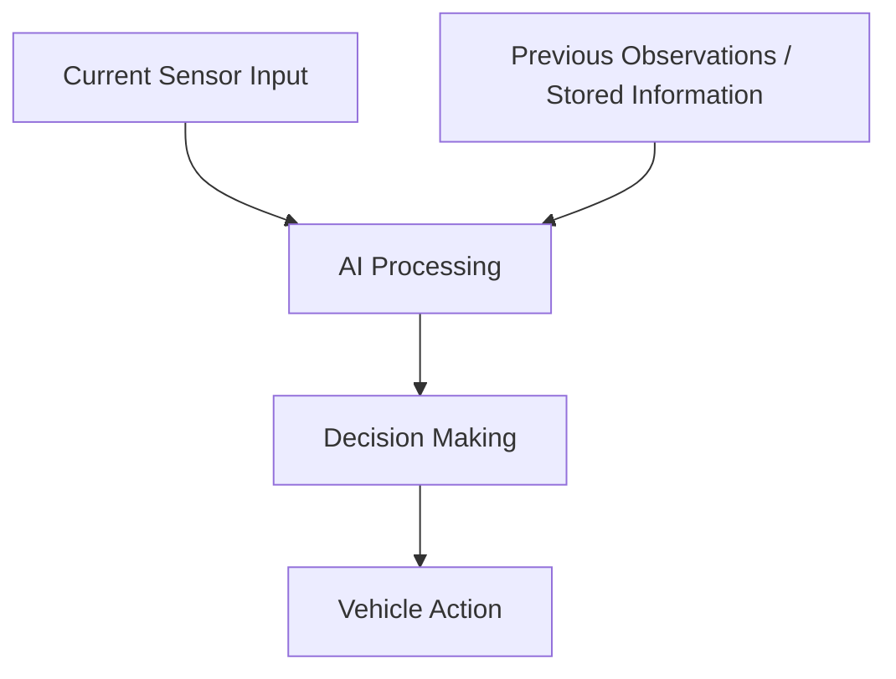

# 🎓 AI Engineer Master Training – Class 03
# Types of Artificial Intelligence

**Level:** Beginner to Advanced  
**Module:** Artificial Intelligence  
**Class:** 03  
**Learning Goal:** Understand the different types of Artificial Intelligence based on capabilities and functionality, with examples and real-world applications.

---

# 📚 1. Introduction to Types of Artificial Intelligence

## 🟢 Telugu Understanding

Artificial Intelligence అంటే ఒకే రకమైన technology కాదు. AI systems కి ఉండే abilities, intelligence level, working methods ఆధారంగా వాటిని different types గా classify చేస్తాము.

ఉదాహరణకు:

- ఒక AI system spam emails ని identify చేస్తుంది.
- ఇంకొక AI system images లో objects ని recognize చేస్తుంది.
- ఇంకొక AI system questions కి answers generate చేస్తుంది.
- Future లో ఒక AI system human లాగా different intellectual tasks చేయగలదని researchers భావిస్తున్నారు.

ఈ systems అన్నీ AI కిందకే వస్తాయి. కానీ వాటి capabilities ఒకేలా ఉండవు.

AI ని ప్రధానంగా రెండు ways లో classify చేస్తారు:

1. Based on Capabilities.
2. Based on Functionality.

## 🔵 English Definition

Artificial Intelligence can be classified into different types based on its capabilities and functionality. These classifications describe the level of intelligence an AI system demonstrates and how it operates.

## 📊 Two Classification Frameworks



**Important:** These are two different classification frameworks. Do not mix the categories from one framework with the other.

---

# 🧠 2. AI Based on Capabilities

## 🟢 Telugu Understanding

ఈ classification లో AI ఎంత స్థాయి intelligence చూపించగలదు అనే దాని ఆధారంగా classify చేస్తాము.

దీనిలో మూడు types ఉంటాయి:

1. Artificial Narrow Intelligence (ANI).
2. Artificial General Intelligence (AGI).
3. Artificial Superintelligence (ASI).

## 🔵 English Definition

Capability-based classification categorizes Artificial Intelligence according to the breadth and level of intelligence it can demonstrate across different tasks.

## 📊 Capability-Based Classification



---

# 🎯 3. Artificial Narrow Intelligence (ANI)

**Also Known As:** Weak AI or Narrow AI

## 🟢 Telugu Understanding

Artificial Narrow Intelligence అంటే ఒక specific task లేదా limited set of tasks కోసం design చేసిన AI.

ఇది ఒక particular task లో చాలా మంచి performance చూపించవచ్చు. కానీ దాని training మరియు design scope కి బయట ఉన్న అన్ని పనులను human లాగా స్వతంత్రంగా చేయలేదు.

ఉదాహరణకు:

- Face Recognition System.
- Google Translate.
- Spam Detection.
- Recommendation Systems.
- Voice Assistants.
- Image Classification Models.

మన phone లో face unlock feature ఉంటుంది కదా!

అది మన face ని recognize చేయగలదు. కానీ అదే system మనతో general conversation చేయడం, cooking చేయడం, driving చేయడం వంటి అన్ని పనులు చేయలేదు.

అందుకే అది Narrow AI.

## 🔵 English Definition

Artificial Narrow Intelligence (ANI) is an AI system designed to perform a specific task or a limited range of tasks. It cannot independently perform every intellectual task across different domains like a human.

## 💡 Real-World Examples

| AI System | Specific Task |
|---|---|
| Face Recognition | Identifying faces |
| Spam Filter | Detecting unwanted emails |
| Google Translate | Language translation |
| Recommendation System | Suggesting products or movies |
| Chess AI | Playing chess |
| Object Detection Model | Detecting objects in images |

## 📌 Practical Example

Imagine a movie recommendation system.

It analyzes a user's movie preferences and recommends similar movies.

It can recommend movies very effectively, but it cannot automatically become an expert in medicine, law, cooking, and every other field.

That is an example of Narrow AI.

## ⭐ Current Status

**Narrow AI exists today and is widely used in real-world applications.**

---

# 🌍 4. Artificial General Intelligence (AGI)

**Also Known As:** Strong AI (in common usage)

## 🟢 Telugu Understanding

Artificial General Intelligence అంటే human లాగా different types of intellectual tasks నేర్చుకొని, అర్థం చేసుకొని, apply చేయగల AI అనే concept.

ఒక మనిషి:

- Maths problems solve చేయగలడు.
- New language నేర్చుకోగలడు.
- Different situations లో decisions తీసుకోగలడు.
- New problems కి solutions కనుగొనగలడు.
- ఒక field లో నేర్చుకున్న knowledge ని మరొక field లో ఉపయోగించగలడు.

ఇలాంటి broad, flexible intelligence ని AI system కూడా సాధించగలిగితే దానిని AGI అంటారు.

AGI అంటే ఒకే task లో expert అవ్వడం కాదు. Different domains లో general intelligence చూపించడం.

## 🔵 English Definition

Artificial General Intelligence (AGI) refers to a hypothetical AI system capable of learning, understanding, and performing a broad range of intellectual tasks at a level comparable to human intelligence.

## 💡 Example – Hypothetical AGI

ఒక hypothetical AGI system కి కొత్త task ఇచ్చామని అనుకుందాం.

```text
Task 1: Learn a new language.
Task 2: Solve mathematical problems.
Task 3: Understand scientific concepts.
Task 4: Plan a complex project.
Task 5: Apply previous knowledge to a new problem.
```

ఇలాంటి different tasks ని flexible గా నేర్చుకొని perform చేయగల general-purpose intelligence AGI లక్షణం.

## 📊 AGI Concept



## ⭐ Current Status

**AGI has not been conclusively achieved.**

Modern AI systems can perform many impressive tasks, but broad, reliable, human-level general intelligence across domains remains an open research challenge.

---

# 🚀 5. Artificial Superintelligence (ASI)

**Also Known As:** Super AI

## 🟢 Telugu Understanding

Artificial Superintelligence అంటే human intelligence కంటే చాలా ఎక్కువ స్థాయిలో intelligence కలిగిన hypothetical AI.

ఒకవేళ future లో ఒక AI system:

- Humans కంటే వేగంగా complex problems solve చేయగలిగితే.
- Advanced scientific discoveries చేయగలిగితే.
- చాలా క్లిష్టమైన reasoning tasks లో humans ని మించగలిగితే.
- Multiple intellectual domains లో humans కంటే superior performance చూపించగలిగితే.

దానిని Artificial Superintelligence అనే concept తో వివరిస్తారు.

ఇది ప్రస్తుతం ఉన్న technology కాదు. Future గురించి theoretical concept మాత్రమే.

## 🔵 English Definition

Artificial Superintelligence (ASI) is a hypothetical form of AI that would surpass human intellectual capabilities across most or all domains, including scientific reasoning, creativity, and complex problem-solving.

## 💡 Hypothetical Example

Imagine ఒక future AI system:

- Humans కంటే వేగంగా scientific discoveries చేయడం.
- Complex global problems కి solutions కనుగొనడం.
- Advanced mathematical problems solve చేయడం.
- Multiple fields లో human experts కంటే superior performance చూపించడం.

ఇది ASI concept ని అర్థం చేసుకోవడానికి hypothetical example.

## ⭐ Current Status

**Artificial Superintelligence does not currently exist. It remains a theoretical possibility.**

---

# ⚖️ 6. Difference Between ANI, AGI, and ASI

## 📊 Comparison Table

| Feature | ANI | AGI | ASI |
|---|---|---|---|
| Full Form | Artificial Narrow Intelligence | Artificial General Intelligence | Artificial Superintelligence |
| Intelligence | Task-specific | General | Beyond human-level |
| Task Range | Limited | Broad | Extremely broad |
| Adaptability | Limited to designed scope | Expected to be flexible | Expected to be highly advanced |
| Current Status | Exists | Not conclusively achieved | Theoretical |
| Example | Spam filter | Hypothetical general AI | Hypothetical super AI |

## 🧠 Easy Way to Remember

```text
ANI → One specific task or limited tasks
AGI → General human-like intellectual abilities
ASI → Intelligence beyond human capabilities
```

**Interview Tip:** ANI, AGI, and ASI are classified based on the breadth and level of intelligence, not simply on how advanced or expensive a system is.

---

# ⚙️ 7. AI Based on Functionality

## 🟢 Telugu Understanding

ఇప్పుడు రెండవ classification చూద్దాం.

ఈ classification లో AI ఎలా పనిచేస్తుంది? దానికి memory ఉందా? Past information ఉపయోగిస్తుందా? Human emotions మరియు intentions అర్థం చేసుకోగలదా? అనే aspects ఆధారంగా classify చేస్తాము.

దీనిలో నాలుగు categories ఉంటాయి:

1. Reactive Machines.
2. Limited Memory.
3. Theory of Mind.
4. Self-Aware AI.

## 🔵 English Definition

Functionality-based classification describes AI systems according to how they process information, use memory, respond to situations, and potentially understand other minds.

## 📊 Functionality-Based Classification



---

# ⚡ 8. Reactive Machines

## 🟢 Telugu Understanding

Reactive Machines అనేవి current input ఆధారంగా response ఇచ్చే basic AI systems.

వాటికి previous experiences ని ఉపయోగించి learning చేసే persistent memory ఉండదు.

అంటే, ప్రస్తుతం ఎదురైన situation ని analyze చేసి response ఇస్తాయి.

ఒక classic example IBM Deep Blue.

Deep Blue chess game లో current board position ని analyze చేసి, possible moves ని evaluate చేసి move select చేసేది.

ఇది మనుషుల్లాగా personal memories store చేసుకొని experience నుంచి learn అయ్యే system కాదు.

## 🔵 English Definition

Reactive Machines are AI systems that respond to current inputs without using stored memories of past experiences to influence future decisions.

## 💡 Example: IBM Deep Blue



## ⭐ Characteristics

- Responds to current input.
- Does not use past experiences as persistent memory.
- Performs specific tasks.
- Does not independently improve through stored experience.

**Example:** IBM Deep Blue is a classic example of a reactive AI system.

---

# 🧠 9. Limited Memory AI

## 🟢 Telugu Understanding

Limited Memory AI అనేది current input తో పాటు గతంలో సేకరించిన లేదా కొంతకాలం store చేసిన information ని కూడా ఉపయోగించగల AI.

ఇది Reactive Machines కంటే advanced approach.

ఉదాహరణకు Self-Driving Cars.

ఒక self-driving car:

- Current camera images ని analyze చేస్తుంది.
- Nearby vehicles position ని observe చేస్తుంది.
- Previous observations ని ఉపయోగించవచ్చు.
- Other vehicles movement ని estimate చేస్తుంది.
- Driving decisions తీసుకుంటుంది.

ఈ information ఆధారంగా car safe గా drive చేయడానికి ప్రయత్నిస్తుంది.

## 🔵 English Definition

Limited Memory AI refers to AI systems that use current observations along with stored or previously observed information to make decisions.

## 💡 Example: Self-Driving Cars

ఒక self-driving car road పై ప్రయాణిస్తున్నప్పుడు:

1. Camera మరియు sensors ద్వారా surroundings observe చేస్తుంది.
2. Nearby vehicles మరియు pedestrians ని detect చేస్తుంది.
3. Their movement and position information ని process చేస్తుంది.
4. Driving decisions తీసుకుంటుంది.

## 📊 Limited Memory Workflow



## ⭐ Characteristics

- Uses current input.
- Can use past or stored information.
- Supports prediction and decision-making.
- Widely used in modern AI applications.

**Examples:** Self-driving vehicle systems and many modern prediction systems.

---

# 💭 10. Theory of Mind AI

## 🟢 Telugu Understanding

Theory of Mind అంటే ఇతర వ్యక్తుల thoughts, emotions, intentions, beliefs వంటి mental states ని అర్థం చేసుకునే ability.

మనుషులు ఒకరి expressions, behaviour, words చూసి వారి feelings ని కొంతవరకు అర్థం చేసుకోగలరు.

ఉదాహరణకు:

ఒక వ్యక్తి బాధగా ఉన్నప్పుడు, అతని facial expression మరియు behaviour చూసి అతనికి emotional support అవసరమని మనం అర్థం చేసుకోవచ్చు.

ఇలాంటి human mental states ని లోతుగా అర్థం చేసుకొని social interactions లో ఉపయోగించగల AI ని Theory of Mind AI అంటారు.

ఇది AI functionality classification లో proposed future category.

## 🔵 English Definition

Theory of Mind AI refers to a hypothetical AI capability involving the understanding and reasoning about human mental states, including emotions, beliefs, intentions, and expectations.

## 💡 Hypothetical Example

Imagine ఒక AI assistant:

- ఒక వ్యక్తి frustrated గా ఉన్నాడని గుర్తించడం.
- అతని intention ని అర్థం చేసుకోవడం.
- Context ఆధారంగా response మార్చడం.
- Social situations కి అనుగుణంగా communicate చేయడం.

ఇలాంటి deeper understanding ని Theory of Mind concept వివరిస్తుంది.

## ⭐ Current Status

**Full Theory of Mind AI has not been achieved.**

Some current AI systems can recognize or respond to emotional cues, but that does not establish that they genuinely understand human mental states in the full Theory of Mind sense.

---

# 🌟 11. Self-Aware AI

## 🟢 Telugu Understanding

Self-Aware AI అంటే తన గురించి తాను awareness కలిగి ఉండే hypothetical AI system.

మనుషులకు:

- మనం ఎవరో తెలుసు.
- మన thoughts గురించి ఆలోచించగలం.
- మన feelings ని గుర్తించగలం.
- మన existence గురించి ఆలోచించగలం.

ఇలాంటి self-awareness AI system కి కూడా ఉంటే దానిని Self-Aware AI అంటారు.

ఇది కేవలం తన own data లేదా internal status గురించి information కలిగి ఉండడం కాదు.

నిజమైన self-awareness లేదా consciousness అనే భావన దీనిలో ఉంటుంది.

## 🔵 English Definition

Self-Aware AI refers to a hypothetical AI system that possesses awareness of its own existence, internal states, and potentially its own experiences or consciousness.

## 💡 Hypothetical Example

ఒక future AI system తన existence గురించి స్వయంగా అవగాహన కలిగి ఉండి, తన internal experiences గురించి reflect చేయగలిగితే అది Self-Aware AI concept కి ఉదాహరణ అవుతుంది.

## ⭐ Current Status

**Self-Aware AI does not currently exist as an established technology.**

A system talking about itself or describing its internal processes does not prove that it is conscious or self-aware.

---

# ⚖️ 12. Difference Between Four Functional Types

| Feature | Reactive Machines | Limited Memory | Theory of Mind | Self-Aware AI |
|---|---|---|---|---|
| Main Concept | Responds to current input | Uses stored information | Understands mental states | Has self-awareness |
| Memory Use | No persistent past-experience memory | Uses past or stored information | Expected to use social understanding | Expected to have self-awareness |
| Learning from Experience | Not a defining capability | May use stored observations or learned models | Hypothetical | Hypothetical |
| Example | IBM Deep Blue | Self-driving systems | Hypothetical social AI | Hypothetical conscious AI |
| Status | Exists | Exists | Not fully achieved | Does not exist as established technology |

---

# 🔍 13. Important Real-World Understanding

## 13.1 Is ChatGPT Narrow AI or AGI?

### 🟢 Telugu Understanding

ChatGPT చాలా different tasks చేయగలదు:

- Questions కి answers ఇవ్వగలదు.
- Code generate చేయగలదు.
- Documents summarize చేయగలదు.
- Different subjects explain చేయగలదు.

అయినా, ఇది automatic గా AGI అయిపోదు.

ఎందుకంటే broad capabilities ఉన్నంత మాత్రాన reliable, flexible, human-level general intelligence సాధించినట్లు కాదు.

అందువల్ల ChatGPT వంటి systems ని ప్రస్తుతం Narrow AI పరిధిలోనే పరిగణిస్తారు.

### 🔵 English Definition

Despite their broad capabilities, current systems such as ChatGPT are generally classified as Narrow AI because they have not demonstrated conclusively established human-level general intelligence across all intellectual domains.

## 13.2 Can a Robot Be AGI?

### 🟢 Telugu Understanding

ఒక robot ఉండటం వల్ల అది AGI అవ్వదు.

Robot అనేది physical machine. AI అనేది దానికి intelligence-related capabilities అందించగల technology.

ఒక robot ఒకే task చేస్తే అది Narrow AI system కావచ్చు.

ఒక robot human-level general intelligence సాధిస్తే అది hypothetical AGI concept లోకి వస్తుంది.

### 🔵 English Definition

A robot is a physical machine, whereas AI refers to intelligent computational capabilities. A robot may use Narrow AI, and physical embodiment alone does not make it AGI.

---

# 🧩 14. Practical Classification Examples

| Example | Classification | Reason |
|---|---|---|
| Email Spam Filter | ANI | Performs a specific classification task |
| Google Translate | ANI | Focuses on language translation |
| IBM Deep Blue | Reactive Machine | Classic example of current-state-based decision-making |
| Self-Driving Car | ANI + Limited Memory approach | Performs a specialized driving task using observations and stored information |
| ChatGPT | ANI | Broad but not established human-level general intelligence |
| Human-Level General AI | AGI | Hypothetical broad intelligence |
| Beyond-Human General Intelligence | ASI | Hypothetical superintelligence |
| Conscious AI | Self-Aware AI | Hypothetical self-awareness |

**Note:** These examples show how the two classification frameworks can describe the same system from different perspectives. For example, a self-driving system can be Narrow AI based on capability and use Limited Memory techniques based on functionality.

---

# 📝 15. Interview Questions and Answers

### Q1. What are the two major classifications of AI?

**Answer:** AI is commonly classified based on capabilities and functionality.

### Q2. What is Artificial Narrow Intelligence?

**Answer:** ANI is an AI system designed to perform specific tasks or a limited range of tasks.

### Q3. What is AGI?

**Answer:** Artificial General Intelligence is a hypothetical AI capability that would allow a system to perform a broad range of intellectual tasks at a level comparable to humans.

### Q4. What is ASI?

**Answer:** Artificial Superintelligence is a hypothetical form of AI that would surpass human intellectual capabilities across most or all domains.

### Q5. Does AGI exist today?

**Answer:** AGI has not been conclusively achieved. It remains an active research goal.

### Q6. What is a Reactive Machine?

**Answer:** A Reactive Machine responds to current inputs without relying on persistent memories of past experiences.

### Q7. What is Limited Memory AI?

**Answer:** Limited Memory AI uses current observations along with stored or previously observed information to make decisions.

### Q8. Give an example of Limited Memory AI.

**Answer:** Self-driving vehicle systems are a common example because they use current sensor inputs and stored or recent observations to make driving decisions.

### Q9. What is Theory of Mind AI?

**Answer:** Theory of Mind AI is a hypothetical AI capability involving the understanding of human emotions, beliefs, intentions, and other mental states.

### Q10. What is Self-Aware AI?

**Answer:** Self-Aware AI is a hypothetical system that would possess awareness of its own existence and internal states.

### Q11. Is ChatGPT AGI?

**Answer:** No. ChatGPT is generally considered a Narrow AI system because broad task capabilities do not establish human-level general intelligence across all domains.

### Q12. What is the difference between ANI and AGI?

**Answer:** ANI focuses on specific tasks, whereas AGI aims to perform a broad range of intellectual tasks with human-like generality.

---

# 🧪 16. Class 03 – Knowledge Check

Try answering these questions without looking at the notes.

1. What are the two major ways of classifying AI?
2. What is the full form of ANI?
3. What is the difference between ANI and AGI?
4. What does ASI represent?
5. Does AGI currently exist as an established technology?
6. Which AI type uses current input without persistent memory of past experiences?
7. What is Limited Memory AI?
8. Why are self-driving cars commonly associated with Limited Memory AI?
9. What is Theory of Mind?
10. What does Self-Aware AI mean?
11. Is ChatGPT considered AGI?
12. What is the difference between a robot and AI?
13. Can one AI system be classified using both frameworks?
14. Why is IBM Deep Blue a classic example of Reactive AI?

---

# 🎯 17. Class 03 – Final Understanding

Artificial Intelligence can be classified in two different ways.

**Based on Capabilities:**

- ANI: Performs specific tasks.
- AGI: Aims for broad, human-level general intelligence.
- ASI: Hypothetical intelligence beyond human capabilities.

**Based on Functionality:**

- Reactive Machines: Respond to current input.
- Limited Memory: Use current and stored information.
- Theory of Mind: Hypothetical understanding of human mental states.
- Self-Aware AI: Hypothetical self-awareness.

**Important:** Narrow AI and Limited Memory are not the same classification. One describes the breadth of an AI system's capabilities; the other describes how it uses information and memory.

---

# 📚 Class 03 Completed

**Next Class:** Class 04 – Major Domains and Applications of Artificial Intelligence

We will explore the major areas of AI, including:

- Machine Learning.
- Deep Learning.
- Natural Language Processing.
- Computer Vision.
- Robotics.
- Speech Recognition.
- Expert Systems.
- Generative AI.

**End of Class 03 – Types of Artificial Intelligence**